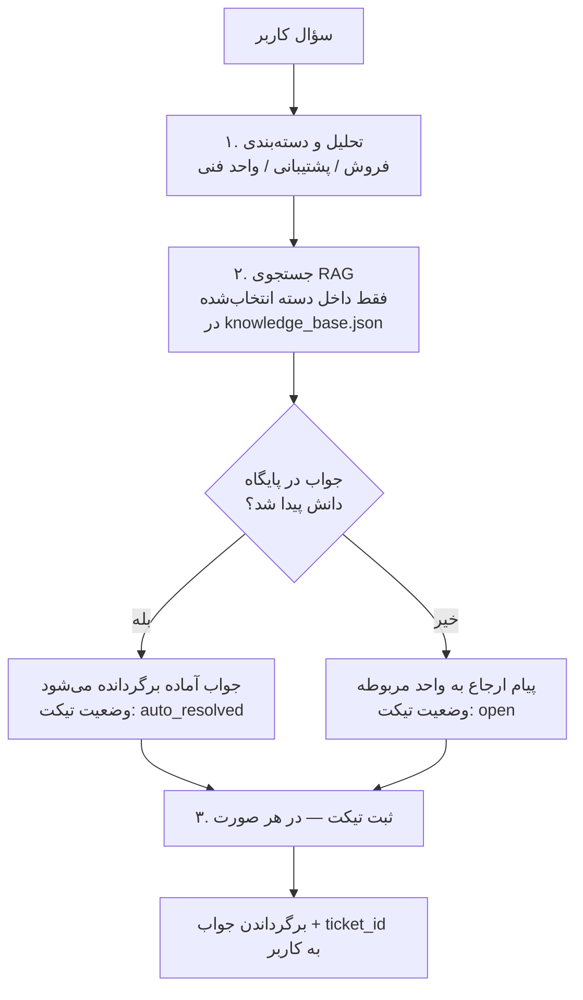

# فلو سیستم (Workflow)

## قواعد قطعی فلو

1. **تیکت همیشه ثبت می‌شود** — چه جواب پیدا شود، چه نشود.
2. جستجوی RAG فقط داخل دسته‌ای انجام می‌شود که کلاسیفایر انتخاب کرده است.
3. اگر هیچ کلیدواژه‌ای به سؤال نخورد، دسته پیش‌فرض «پشتیبانی» است (`is_default=true`).
4. شناسه تیکت یکتاست: `TKT-YYYYMMDD-XXXX`
